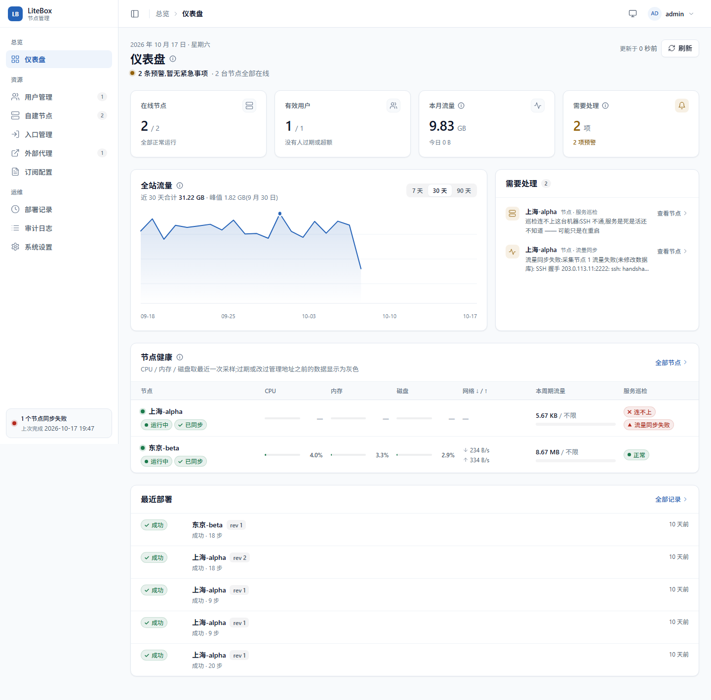
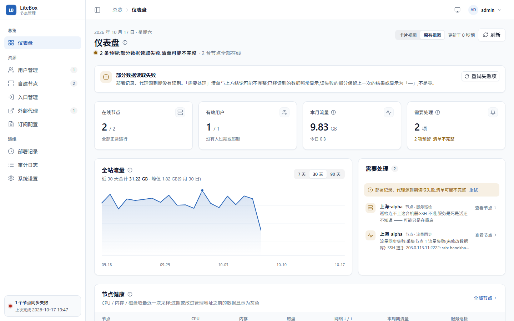
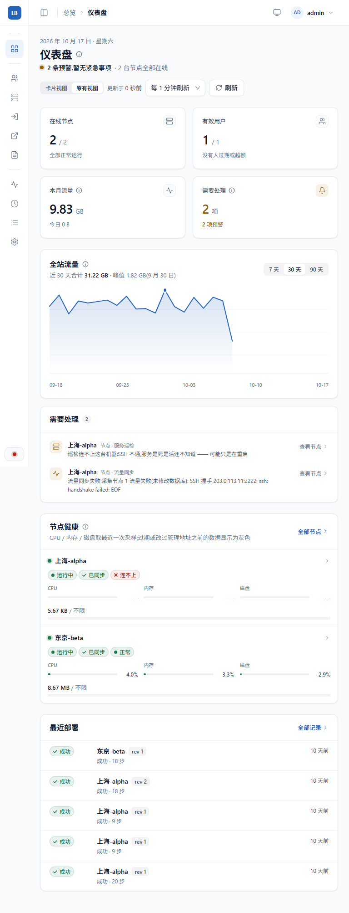
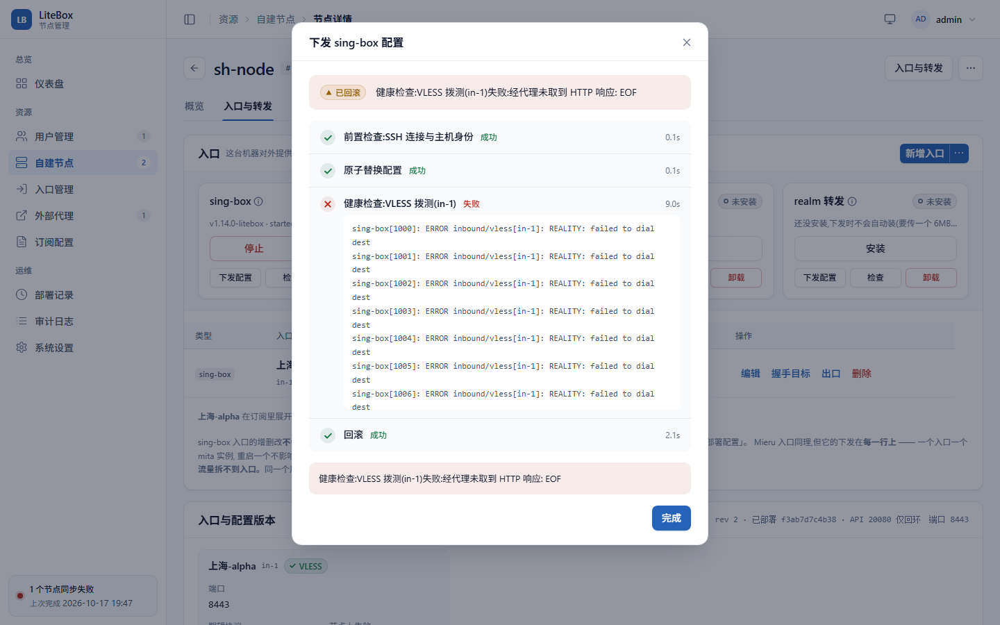
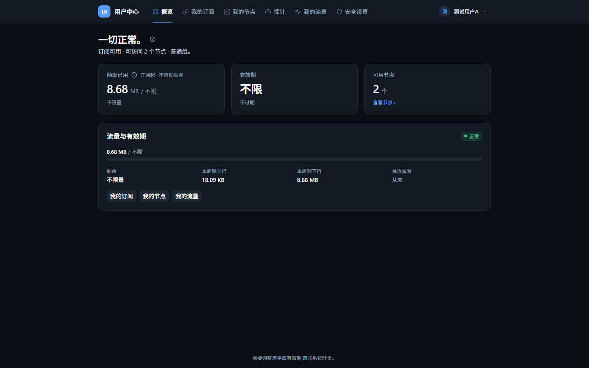
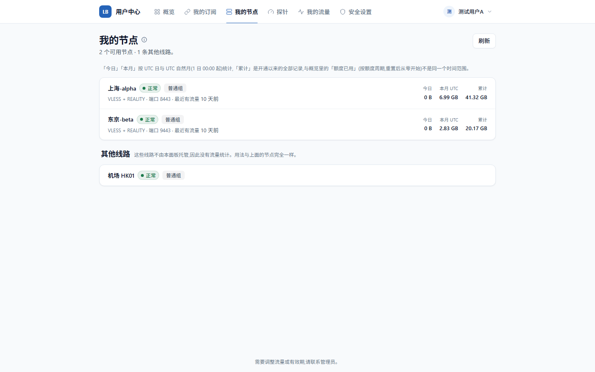

# UI 2.0.1 · 稳定性与体验收尾

> 分支 `feat/ui-2.0`,起点 `7790978`(与 master 相同)。不做视觉重构、不换组件库、不改业务架构;
> 修的都是「不报错,但让人读错」的地方,外加一套不连后端的前端回归测试。
> 约束写进 CLAUDE.md「UI 2.0.1 稳定性约束(V21.1)」。

## 结论

**建议合并 master**,前提是推到远程后 GitHub Actions 的首次运行是绿的(见「风险」R1)。
依据:

1. P0 三项、P1 三项全部完成,每项有回归用例;另外测试抓出并修掉了两个**既有的线上 bug**,
   其中「下发配置」误传 force 让每一次普通下发都强制重启 sing-box —— 这个 bug 现在就在
   master(从 V20 起)上,越早合并越好;
2. 94 个功能用例 + 26 张截图基线在本机全过,功能用例对生产构建(`vite preview`)也全过;
   Go 全量测试、`go vet` 通过;
3. 真机(djj-ph)验证:修复后的「下发配置」返回「配置已一致」,sing-box 进程 PID 与运行时长
   前后一致;TCP 调优检查、探测在真实数据下弹窗正常;
4. 构建体积 +0.42%(JS)/ +0.27%(CSS),生产依赖不变。

## 修复清单

| # | 优先级 | 问题 | 修复 | 提交 | 回归用例 |
|---|---|---|---|---|---|
| 1 | P0-1 | 仪表盘只有预警读失败才改口;节点(含商家到期)、部署记录、代理源 / 外部代理到期、流量同步状态读失败被静默吞掉,结论照样「一切正常」 | 失败来源统一进 `failedSources`:顶部提示点名、「重试失败项」只重跑失败的;严重项优先;刷新失败保留旧结果 | `7917874` | `dashboard.spec.ts` 12 条 |
| 2 | P0-1 | 「需要处理」不收服务巡检与流量同步:一台「连不上」、同步一直失败的机器旁边写着「一切正常」 | 服务没在跑 / 自动恢复失败 → 严重;SSH 连不上、同步失败 → 预警(V10 口径) | `c0feff1` `8e2aa5c` | `dashboard.spec.ts` 3 条 |
| 3 | P0-3 | 门户概览把额度周期内的用量标成「本月流量」,与「我的节点」按 UTC 自然月算的「本月」撞名 | 核对口径:统计都对,只改标签。「额度已用」+ 周期(X 月 X 日起 / 开通起 · 重置日)、「本月 UTC」、「累计」各写清;「更新」改「最近有流量」 | `68a152c` | `portal.spec.ts` 4 条 |
| 4 | P0-2 | 没有任何前端自动化测试与 CI | Playwright + 接口模拟 + 固定数据 + 截图基线 + GitHub Actions | `b82d639` | — |
| 5 | P1-6 | 侧栏同时写着「N 个节点同步失败」与「上次 尚未运行」;删掉 / 停用的机器的失败记录永远不清 | 接口加 `running` / `last_started` / `failed_at`;每轮开始丢掉不在名单里的机器的失败;文案收进 `syncStatus.ts`,失败永不说正常;每分钟重拉 | `84f2579` | `schedulerstatus_test.go` 3 条 + `layout.spec.ts` 5 条 |
| 6 | P1-4 | 静态确认框按钮写成「取 消」「部 署」,深色模式下是一张浅色卡 | `ConfigProvider.config` 给静态弹窗同一份主题、zh_CN、不插空格 | `66fe33b` | `modals.spec.ts` |
| 7 | P1-4 | 拨测失败带回上百行日志,把「回滚」那一步推出几屏;引导结果的多段说明挤成一段 | 单步日志封顶 280px 内滚;确认框正文 `pre-line` | `66fe33b` | `node-detail.spec.ts`、`modals.spec.ts` |
| 8 | P1-4 | 探测 / 调优跑完 `reload()` 把整页切回骨架,结果弹窗被卸载再挂上 | 同一台机器就地刷新 | `c430ab7` | `modals.spec.ts` |
| 9 | P1-5 | 768 宽下入口管理、外部代理的「操作」列在屏幕外;仪表盘节点健康横向滚 | 操作列固定在右侧;节点健康 <1024 换卡片 | `38adf4b` | `responsive.spec.ts` 5 条 |
| 10 | P1-5 | 49 处没有 href 的 `<a @click>`、5 处可点的 div / li:键盘到不了 | 跳页的改 `RouterLink`,页内动作改 `button.lb-linkbtn` | `190dd3c` | `responsive.spec.ts` 4 条、`nodes.spec.ts` |
| 11 | 既有 bug | 服务卡片「下发配置」把点击事件当成 `force` 传入:**每次普通下发都强制重新下发、配置一致也重启 sing-box** | `() => deploySingBox()` | `487ad77` | `node-detail.spec.ts` 断言请求体 `{ force: false }` |
| 12 | 既有 bug | 节点部署记录读失败显示「还没有部署记录」,概览的失败横幅也消失 | 单独的失败态与重试,有旧数据时保留 | `c430ab7` | `node-detail.spec.ts` |

## 测试

```bash
cd web
npm run test:e2e          # 94 个功能用例
npm run test:e2e:visual   # 26 张截图基线(本机)
npm run typecheck:e2e
cd .. && go test ./... -count=1
```

| 项 | 结果 |
|---|---|
| Playwright 功能(开发服务器) | 94 passed |
| Playwright 功能(生产构建 `E2E_PREVIEW=1`) | 94 passed(27 s) |
| Playwright 截图基线 | 26 passed,连跑两遍稳定 |
| 全部 Playwright | 120 passed(33 s) |
| Go | `go test ./...` 24 个包通过;`go vet ./...` 通过 |
| 类型检查 | `vue-tsc`、e2e 的 `tsc` 通过;按 hunk 拆分的三个提交各自单独通过 |

覆盖范围:登录 / 守卫(管理端与门户各自)、主题三档与跟随系统、侧栏导航 / 面包屑 / 折叠 / 手机抽屉 /
退出、侧栏同步状态五种说法、仪表盘部分失败与清单来源、节点列表(搜索、行内菜单、键盘)、节点详情
五个 Tab、入口菜单、下发的取消 / 确认 / 回滚 / 连接中断、四种检查弹窗在 1440 与 390 下的长内容、
门户口径标签与各页、768 与 390 响应式、键盘可达。

**安全**:接口一律模拟,写操作没有显式模拟就判失败,拦截层是 auto 夹具,vite 代理指向没人监听的端口。
固定数据对着本机 scratch 面板只读录制,经 `sanitize.mjs` 脱敏并人工核对(真实 IP、主机别名、
公钥、token、哈希都已替换)。细节见 `web/e2e/README.md`。

## 截图与交互验收

截图基线就是验收图,在 `web/e2e/__screenshots__/visual.spec.ts/`(win32):

| 页面 | 图 |
|---|---|
| 仪表盘(巡检连不上 + 同步失败进清单) |  |
| 仪表盘部分失败 |  |
| 仪表盘 · 768(节点健康换卡片) |  |
| 部署失败并回滚的进度弹窗 |  |
| 门户概览 · 深色(「额度已用」与周期) |  |
| 门户我的节点(三种时间范围说明) |  |

真机交互(scratch 面板 → djj-ph,Alpine 3.24 / arm64 / OpenRC / NAT):

| 操作 | 结果 |
|---|---|
| 入口 Tab → sing-box 卡片「下发配置」 | 确认框按钮「取消」「部署」;进度弹窗标题「下发 sing-box 配置」(修复前是「强制重新下发」);结论「配置已一致,这次没有重启服务」;节点上 `sing-box run` 进程 PID 3176、运行 10d02,前后一致 |
| TCP 调优检查 | 25 项、只读,弹窗内滚,「显示全部 25 项」是按钮;未点「应用调优」 |
| 探测 · 390 宽 | 弹窗全宽、内滚、ESC 可关 |

sh-kurun 在验收当天从 scratch 面板 SSH 握手失败(EOF),只用于说明「连不上」状态,没有对它做任何操作。

## 构建体积

| | 基线 `7790978` | 本轮 | 变化 |
|---|---|---|---|
| JS | 2153.8 KB | 2162.8 KB | +9.0 KB(+0.42%) |
| CSS | 451.3 KB | 452.5 KB | +1.2 KB(+0.27%) |
| dist 合计 | 9730.6 KB | 9740.7 KB | +10.1 KB(+0.10%) |

生产依赖不变;新增的只有开发依赖 `@playwright/test`(锁定 1.63.0)。

## 风险与遗留

| # | 优先级 | 内容 | 建议 |
|---|---|---|---|
| R1 | 高 | GitHub Actions 还没在远程跑过(没有推送)。Linux 上字体度量不同,几条量位置的用例(768 操作列、弹窗边界)理论上可能有差 | 推送后看首次运行;失败的话按 Linux 结果调整断言,不放宽安全规则 |
| R2 | 中 | 固定数据是录制那一刻的接口形状。后端改 DTO 之后测试仍按旧形状跑,可能「绿着」漏掉前后端不一致 | 改接口的提交顺带重录(README 有步骤);后续可加一条用 Go 测试生成 DTO 样例的契约测试 |
| R3 | 中 | 「需要处理」新增巡检与同步两类:此前显示「一切正常」的环境升级后可能出现预警 | 这是有意的行为变化,发布说明里写一句 |
| R4 | 中 | `lb-linkbtn` 替换覆盖 15 个文件,截图基线只覆盖 6 个页面;用户详情抽屉、设置、外部代理等页的按钮样式靠肉眼抽查 | 合并前在 scratch 面板把这几页过一遍;后续把它们加进 `@visual` |
| R5 | 低 | 截图基线只有 win32 一份 | 需要时在 Linux 上 `npm run test:e2e:update` 补一份 `-linux` |
| R6 | 低 | 侧栏同步状态每分钟多一次轻量请求(页面隐藏时不发) | 无 |
| R7 | 低 | 入口 Tab 的说明里写「部署配置」,按钮叫「下发配置」;`phase0/statsprobe/main.go` 未 gofmt | 与本轮无关,未顺手改;CI 的 gofmt 检查排除了 `phase0/` |

## 提交

```
84f2579 fix(sync): 侧栏同步状态不再同时说「N 个节点失败」与「尚未运行」
7917874 fix(dashboard): 任何来源读失败都不再显示「一切正常」
68a152c fix(portal): 分开「额度已用」与 UTC 自然月「本月」的标签
487ad77 fix(node): 服务卡片的「下发配置」不再被当成强制重新下发
c430ab7 fix(node-detail): 部署记录读失败不再说「还没有部署记录」;刷新就地进行
66fe33b fix(modal): 静态弹窗跟随主题与语言包;长日志框内滚动;确认框正文保留换行
38adf4b fix(responsive): 768 宽下表格的操作够得着,仪表盘节点健康不再横向滚
190dd3c feat(a11y): 链接式操作改成键盘可达的元素
c0feff1 fix(dashboard): 服务巡检与流量同步失败也进「需要处理」
8e2aa5c fix(dashboard): 同步失败条目只用后端原文,不重复「数据库未改动」
b82d639 test(web): 引入 Playwright 前端回归测试与 CI
```

每个提交可以单独回滚;按 hunk 拆分的三个(`c430ab7`、`66fe33b`、`38adf4b`)各自单独做过类型检查。
